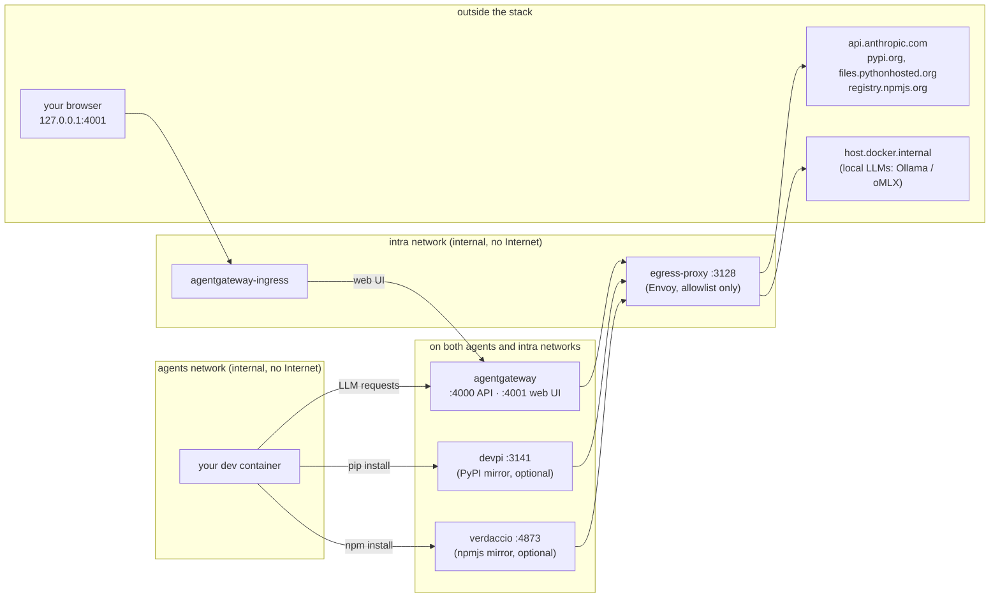

# iron-curtain

A Docker Compose stack providing isolated environment for develompent containers.

The main goal is to secure the development environment, whether it is used by a human or by
an AI agent (e.g. Claude Code). Any code you run during development can be malicious: a
compromised dependency, a package install script, or an agent that has been tricked by a
prompt injection. iron-curtain limits what such code can reach and where it can send it:

- **Network isolation stops data exfiltration.** Dev containers have no direct route to the
  Internet. This makes it much harder for malicious code (or a misbehaving agent) to send out
  source code, secrets or other data the development environment can read.
- **Containers limit the blast radius.** Because development happens inside a container, only
  the files you mount into it are reachable. Credential stores, SSH/GPG keys, documents,
  email, browser cookies and browsing history on the host stay out of reach. On macOS, also
  [restrict Docker Desktop file sharing](#docker-desktop-for-mac-restrict-file-sharing).
- **The gateway keeps provider API keys out of dev containers.** LLM API keys are stored only
  in the gateway, so code in the dev container can't read them. The exception is the Claude
  subscription route, where the client must send its own OAuth token (see
  [Anthropic API using a Claude subscription (Pro/Max)](#anthropic-api-using-a-claude-subscription-promax)).
- **All LLM traffic goes through one place.** The gateway lets you see requests and track
  token spend.

## How it works



- **Agents network (`iron-curtain_agents`):** an internal Docker network with no Internet
  access. Your dev container joins this network. Only agentgateway and the package mirrors
  (devpi, verdaccio) are reachable from it.
- **Intra network:** a second internal network that connects the services to each other.
  Never attach dev containers to it. Only two services are also connected to the outside: the
  egress-proxy (for outbound traffic) and agentgateway-ingress (which publishes the web UI on
  `127.0.0.1:4001` on the host).
- **[agentgateway](https://agentgateway.dev/):** the LLM gateway. From the agents network it is
  at `http://agentgateway:4000`. It routes requests by model-name prefix:
  - `anthropic/<model>` goes to the Anthropic API, using the gateway's `ANTHROPIC_API_KEY`
  - `claude/<model>` goes to the Anthropic API, using your Claude subscription's OAuth token
    sent by the client (see [Anthropic API using a Claude subscription (Pro/Max)](#anthropic-api-using-a-claude-subscription-promax))
  - `ollama/<model>` goes to Ollama on the host (port 11434)
  - `omlx/<model>` goes to oMLX on the host (port 8000)
- **devpi (optional):** a local PyPI mirror that fetches packages from public PyPI on
  demand. From the agents network it is at `http://devpi:3141/root/pypi/+simple/`. Enable it
  with the `python` Compose profile.
- **verdaccio (optional):** a local mirror of the public npm registry. From the agents network
  it is at `http://verdaccio:4873`. Enable it with the `js` Compose profile.
- **egress-proxy:** agentgateway, devpi and verdaccio cannot reach the Internet directly. All
  of their outbound traffic goes through an Envoy proxy that allows only the hosts shown in the
  diagram above (see [egress-proxy/envoy.yaml](egress-proxy/envoy.yaml)).

### Why local package mirrors instead of a proxy?

A simpler setup would let dev containers reach `pypi.org` or `registry.npmjs.org` through an
allowlisting HTTP proxy. That is not enough to stop data exfiltration. A package registry is
not read-only: anyone with a free account can publish to it. Malicious code could pack your
source code or secrets into a package and upload it (an HTTP `POST`/`PUT`) to the public
registry, then download it from anywhere. Because the upload goes to an allowed host, a
host-based allowlist can't tell it apart from a normal `pip install` or `npm install`.

The mirrors close this gap. Dev containers never talk to public registries directly. They
talk only to devpi and verdaccio, which fetch packages from the upstream registries
themselves and only ever *read* from them. Nothing a dev container sends to a mirror is
forwarded upstream: verdaccio is configured with `publish: nobody`, and
devpi's `root/pypi` index is a read-only mirror of PyPI.

## Local LLMs

The stack has been tested with two local inference engines running on the host:

- **[oMLX](https://github.com/jundot/omlx) (recommended):** use the `omlx/` model prefix.
  The gateway expects it on port 8000.
- **[Ollama](https://ollama.com/):** use the `ollama/` model prefix. The gateway expects it on
  port 11434.

Both engines run on the host, outside the stack, so the egress-proxy does not limit their
outbound traffic. Use an application firewall such as
[Little Snitch](https://www.obdev.at/products/littlesnitch/) (macOS) to control which hosts
they can connect to. For example, allow model downloads only when you need them and block
everything else.

## Usage

### 1. Configure

Create a `.env` file in the repository root (it is git-ignored):

```sh
# Needed for anthropic/* models
ANTHROPIC_API_KEY=sk-ant-...
# Needed for omlx/* models, if your oMLX server requires a key
OMLX_API_KEY=...
# Password for the agentgateway web UI (user: admin)
AGENTGATEWAY_UI_PASSWORD=change-me
# Initial devpi root password (only used with the python profile)
DEVPI_INITIAL_ROOT_PASSWORD=change-me
```

API keys stay inside the gateway and are never exposed to your dev containers.

### 2. Start the iron-curtain stack

The stack uses free images from [Docker Hardened Images (dhi.io)](https://docs.docker.com/dhi/),
which require a login (`docker login dhi.io`).

```sh
docker compose up -d
```

The package mirrors are not started by default. Enable them with Compose profiles. To start
the stack with the devpi PyPI mirror, run:

```sh
docker compose --profile python up -d
```

To start the stack with the verdaccio npm mirror, run:

```sh
docker compose --profile js up -d
```

Profiles can be combined:

```sh
docker compose --profile python --profile js up -d
```

The `all` profile enables everything:

```sh
docker compose --profile all up -d
```

The agentgateway web UI (request logs, token usage) is at
[http://127.0.0.1:4001](http://127.0.0.1:4001). Log in as `admin` with
`AGENTGATEWAY_UI_PASSWORD`.

### 3. Attach your dev container

Start your dev container on the `iron-curtain_agents` network, for example:

```sh
docker run -it --rm --network iron-curtain_agents --entrypoint bash dhi.io/claude
```

### 4. Point Claude Code and package managers to the gateway and mirrors

Inside the dev container, set:

```sh
export ANTHROPIC_BASE_URL=http://agentgateway:4000
# The real key lives in the gateway, but Claude Code needs this variable to be set,
# otherwise you'll get login errors.
export ANTHROPIC_AUTH_TOKEN=dummy
export DISABLE_AUTOUPDATER=1
export CLAUDE_CODE_DISABLE_NONESSENTIAL_TRAFFIC=1
export PIP_INDEX_URL=http://devpi:3141/root/pypi/+simple/
export PIP_TRUSTED_HOST=devpi
export NPM_CONFIG_REGISTRY=http://verdaccio:4873
```

The `PIP_*` and `NPM_CONFIG_REGISTRY` settings only work if the matching profile (`python`
or `js`) is enabled.

### 5. Configure model access

Use model names with a provider prefix. Below are a few Claude Code configuration examples
for different providers.

#### Anthropic API

Using the Anthropic API requires `ANTHROPIC_API_KEY` to be set for the gateway in step
[1. Configure](#1-configure).

```sh
export ANTHROPIC_DEFAULT_SONNET_MODEL=anthropic/claude-sonnet-5-5
export ANTHROPIC_DEFAULT_OPUS_MODEL=anthropic/claude-opus-5-5
export ANTHROPIC_DEFAULT_HAIKU_MODEL=anthropic/claude-haiku-5-5
```

#### Anthropic API using a Claude subscription (Pro/Max)

Alternatively, use the `claude/` prefix to access Anthropic models through a Claude
subscription (Pro/Max). The gateway has no credentials for this route. It forwards the
OAuth token that the client sends.

To get an OAuth token, run `docker run -it dhi.io/claude setup-token` on the host and follow
the instructions. The token is valid for one year. Pass it to Claude Code in the
`ANTHROPIC_AUTH_TOKEN` environment variable (this replaces the `dummy` value from step 4):

```sh
export ANTHROPIC_AUTH_TOKEN=sk-ant-...
export ANTHROPIC_DEFAULT_SONNET_MODEL=claude/claude-sonnet-5-5
export ANTHROPIC_DEFAULT_OPUS_MODEL=claude/claude-opus-5-5
export ANTHROPIC_DEFAULT_HAIKU_MODEL=claude/claude-haiku-5-5
```

The token is visible to everything running in that shell session, including untrusted code.
Because of the network isolation, it can only be used through the gateway.

#### Local model served by oMLX

The right configuration for local models depends on your hardware and downloaded models.
The example below was tested on an M2 MacBook Pro with 32 GB RAM:

```sh
export ANTHROPIC_DEFAULT_SONNET_MODEL=omlx/Qwen3-Coder-30B-A3B-Instruct-4bit
export ANTHROPIC_DEFAULT_OPUS_MODEL=omlx/Qwen3-Coder-30B-A3B-Instruct-4bit
export ANTHROPIC_DEFAULT_HAIKU_MODEL=omlx/Qwen3.5-4B-4bit
export MAX_THINKING_TOKENS=0
export CLAUDE_CODE_MAX_CONTEXT_TOKENS=49152
export CLAUDE_CODE_DISABLE_TERMINAL_TITLE=1
```

### 6. Run Claude Code

Start Claude Code (`claude`) in the container and send a prompt to check that the configured
models respond.

#### Using a devcontainer

The stack works well with [Dev Containers](https://containers.dev/).
[.devcontainer/devcontainer.json](.devcontainer/devcontainer.json) is a working example. It
attaches to the agents network, sets the environment variables above, and installs Claude Code.
It defaults to the `claude/` models. Override them by setting the variables in your host
environment, e.g.
`ANTHROPIC_DEFAULT_OPUS_MODEL=omlx/Qwen3.8-27B-4bit`.

## Docker Desktop for Mac: restrict file sharing

By default, Docker Desktop for Mac shares large parts of the host filesystem with its Linux VM:
`/Users`, `/Volumes`, `/private`, `/tmp` and `/var/folders`. This means your whole home
directory is available to the VM. Anything that can create a container with a bind mount
(for example, a process that gets access to the Docker socket, or code that escapes a
container) can then read and modify your files. Network isolation can't prevent this.

Share only the directories your dev containers actually need:

1. Open Docker Desktop and go to **Settings → Resources → File sharing**.
2. Remove the broad default entries (`/Users`, `/Volumes`, `/private`, `/tmp`,
   `/var/folders`). Select an entry and click **−**.
3. Click **+** and add only the specific directories you need, e.g. the project
   directories you open in dev containers (`/Users/<you>/src/my-project`) and this
   repository (Compose bind-mounts files from it).
4. Click **Apply & restart**.

If a container later fails to start with a "mounts denied" or "path is not shared" error,
add that specific path rather than restoring the broad defaults. Some tools bind-mount
temporary files from `/var/folders` or `/tmp`. If you need them, consider re-adding a
narrower subdirectory instead.

## Notes

- The agentgateway config is copied from
  [agentgateway/default-config.yaml](agentgateway/default-config.yaml) into a Docker volume
  on first start only. Later edits to that file have no effect unless you remove the
  `iron-curtain_agentgateway-config` volume. API keys are reapplied from `.env` on every
  start.
